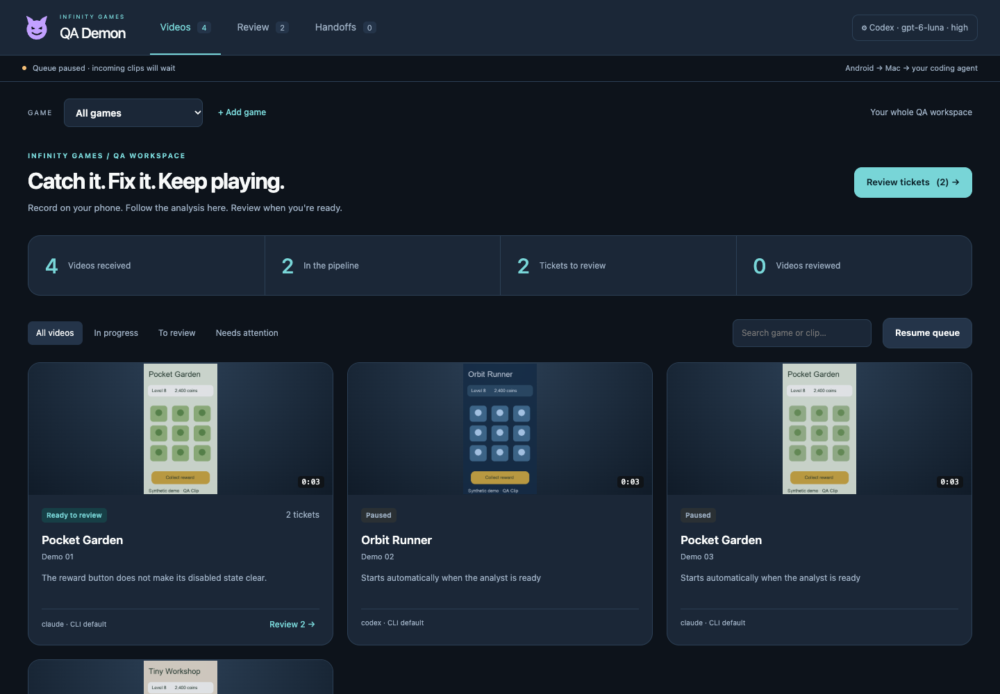
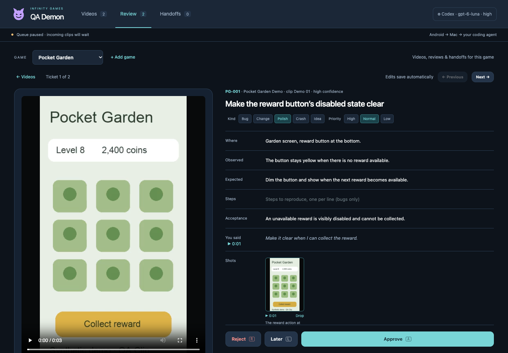

# 😈 QA Demon

**Catch a bug on Android. Review a ticket on your Mac. Hand it to your coding agent.**

QA Demon keeps a configurable **0–30 second lookback** (10 seconds suggested) before you press Volume Up and keeps recording until you press it again. Your voice goes with the video. The QA Demon desktop app receives clips over USB or Wi-Fi, analyses them through **Codex CLI or Claude Code**, and turns findings into editable tickets.

**Previously called QA Clip / QA Desk.** Updates install over the existing Android app; keep your app data. Existing inboxes, pairing, and the `QA Desk.command` launcher continue to work.

**Android 10+ phones · macOS laptops · Python 3.10+ · local files · bring your own CLI login**



## The workflow

1. **Capture.** Start a QA Demon session on Android and play your game. Press **Volume Up** when you see something; press again to finish. **Volume Down** discards an active clip.
2. **Follow the queue.** Videos appear automatically after transfer completes, even while another video is being analysed. The Videos view shows queued, extracting, transcribing, analysing, ready, and failed clips. Search by game, filter by status, pause the queue, or retry a failed clip.
3. **Review one ticket.** Watch the relevant moment, edit the finding, inspect screenshots, then approve, reject, or leave it for later. Edits save automatically. Approval and rejection have Undo.
4. **Hand off.** Approved tickets collect by game. Copy or drag a prompt into your coding agent. Prompts include reproduction steps, acceptance criteria, and local paths to evidence. Every handoff is saved; copying again does not overwrite earlier handoffs.



Analysis runs **one video at a time**, in arrival order. Receiving, queue updates, and ticket review continue independently. Closing QA Demon stops processing; unfinished work is queued again on the next launch. Pausing lets the current analysis finish and holds subsequent videos.

## Install with your agent

Give Codex or Claude Code this prompt:

> Install QA Demon from https://github.com/guilhermea-infinity/qa-demon on my Mac and Android phone. Read AGENTS.md and docs/INSTALL-AGENT.md first. Inspect existing tools and preserve my clips and settings. Ask which CLI and model I want to use, install the missing dependencies, download the current prebuilt Android APK (or build it if needed), and install it on my chosen USB-connected phone. Walk me through the Android permissions and verify a short test clip reaches QA Demon and becomes a reviewable ticket. Leave me the launch command and explain anything you could not verify.

The detailed [agent installation runbook](docs/INSTALL-AGENT.md) includes prerequisites, exact commands, human permission steps, verification, and recovery. This repository does not support iOS, Windows, or Linux desktop installation yet.

## Manual quick start

```bash
git clone https://github.com/guilhermea-infinity/qa-demon.git
cd qa-demon
bash scripts/setup-mac.sh --brew
```

This uses Homebrew for Python, ffmpeg, whisper.cpp, Java 21 and Android platform tools, and creates an isolated `.venv`. Install [Homebrew](https://brew.sh/) first if needed. Without `--brew`, the script installs only the Python dependencies.

Install and sign in to **one** provider:

```bash
# OpenAI / ChatGPT through Codex CLI
npm install -g @openai/codex
codex login

# Or Claude Code
npm install -g @anthropic-ai/claude-code
claude auth login
```

The npm commands require Node.js; `brew install node` if absent. See the [Codex CLI documentation](https://developers.openai.com/codex/cli/) and [Claude Code setup](https://code.claude.com/docs/en/setup) for other installation methods.

Launch your chosen provider:

```bash
./QA\ Demon.command --provider codex
# or
./QA\ Demon.command --provider claude --model sonnet
```

The browser opens at **http://127.0.0.1:8800**. After initial setup, double-click **QA Demon.command**. Keep its Terminal window open while testing.

**Choose a model:** open analyst settings at the top right. QA Demon reads the installed CLI’s model catalog and shows each model’s supported reasoning efforts. Choose **Use CLI configured default** to keep your CLI configuration, or select a listed model and effort. **Refresh models** reloads the catalog (normally cached for five minutes). Models and capabilities vary by CLI version and account; a catalog entry is not a guarantee of quota or access. Discovery does not send a clip or inference prompt. If discovery fails, the page explains why and preserves your saved choice. Settings apply to the next video; the current analysis keeps its original provider, model, and effort. No API key is needed with supported subscription login.

**Choose a game:** on Android, tap the game name; use **+ Add game**, type one name, and you’re done. The Mac has the same quick-add flow. Names sync with your paired Mac over USB or Wi-Fi, and phone additions work offline. The phone’s selected game labels new clips; **Detect automatically** uses the foreground app’s name. QA Demon’s game picker filters videos, reviews, and handoffs without stopping the queue or changing the phone’s selection. Existing clips keep their original attribution.

**Catch bugs after they happen:** the phone’s **Lookback** slider keeps 0–30 seconds before the first Volume Up press. **10 seconds is suggested** because it gives you time to notice a bug and react, without adding too much footage. This can capture a one-off bug you cannot reproduce. Set 0 to start recording only when you press; longer windows use more memory. Lookback starts buffering only after screen-sharing consent and stops with the session. Change it before starting a session. The actual lead-in may be shorter just after starting, or slightly longer to begin on a playable video keyframe.

### Enable voice transcription

Voice is transcribed locally by whisper.cpp before analysis. Install a multilingual model for your preferred balance of speed and accuracy:

```bash
mkdir -p "$HOME/.cache/whisper"
curl -fL --retry 3 \
  https://huggingface.co/ggerganov/whisper.cpp/resolve/main/ggml-small.bin \
  -o "$HOME/.cache/whisper/ggml-small.bin"
```

This downloads roughly 466 MB. Alternatively set `QA_WHISPER_MODEL=/absolute/path/to/ggml-model.bin`. Existing medium/small models in the documented cache locations are detected automatically. Without whisper or its model, visual analysis still works, but spoken instructions are unavailable to the analyst.

### Install on Android

For a prebuilt APK, download it from [Releases](https://github.com/guilhermea-infinity/qa-demon/releases), verify the published SHA-256, and put it in `out/`. Or build locally:

1. Install Android Studio, then SDK Platform **36** and Build Tools **35.0.0** in SDK Manager. Java 21 was installed by the setup script.
2. Set `ANDROID_HOME` if the SDK is not at `~/Library/Android/sdk`.
3. On your phone, enable Developer options and USB debugging. Connect by USB and approve the computer's debugging prompt.

```bash
./build.sh
./mac/install-phone.sh
# With multiple phones: ./mac/install-phone.sh SERIAL
```

On the phone:

- Enable **QA Demon volume buttons** in Accessibility settings. If blocked for a sideloaded app, use Settings → Apps → QA Demon → ⋮ → **Allow restricted settings**, then return to Accessibility.
- Allow microphone access and notifications when requested.
- Choose a game and your lookback window (10 seconds suggested).
- Tap **Start session** and approve Android's screen-sharing prompt. Choose the whole screen when Android offers a choice.
- Open your game. Press Volume Up to start a clip, speak about the issue, and press Volume Up again to send it.

The phone tries the last reachable Mac, Bonjour on Wi-Fi, then USB (`adb reverse`). A new Wi-Fi phone requires approval on the Mac. USB connections are trusted. Clips wait on the phone if the Mac is offline, and only become sent after the Mac acknowledges the complete transfer. The last 20 sent clips remain on the phone.

## Review controls

| Action | Control |
| --- | --- |
| Approve and move on | **A**, or **⌘ Enter / Ctrl Enter** while editing |
| Reject | **R**, with Undo |
| Leave for later | **L** |
| Move between tickets | Previous / Next |
| Reanalyse with a correction | “Redo this clip with a hint” |
| Inspect a screenshot | Click it; Escape closes it |
| Remove a screenshot from the handoff | Drop, or Use to restore |

Letter shortcuts only operate in Review, outside text fields and dialogs. Redo replaces that clip's unapproved drafts while preserving already approved tickets.

## Commands and diagnostics

```bash
.venv/bin/python scripts/doctor.py --provider codex
.venv/bin/python mac/qa-desk.py --help
.venv/bin/python -m unittest discover -s tests -v
```

| Option | Effect |
| --- | --- |
| `--provider claude\|codex` | Select and save a provider; resets the model to CLI default unless supplied |
| `--model MODEL` | Select and save an explicit model; `--model ""` restores CLI default |
| `--inbox DIR` | Use a different data directory |
| `--paused` | Start receiving without starting new analyses |
| `--from-now` | Skip previously unseen clips already in the inbox; does not erase existing work |
| `--no-inbox` | Use an independently running receiver |
| `--port N` | Change the local review port (default 8800) |
| `--no-open` | Start without opening a browser |

A failed analysis shows its error and a Retry button. If sign-in expires, clips wait until the selected CLI is signed in. Unknown models and quota errors remain visible rather than silently falling back to another provider. Full CLI output and extracted evidence are retained in `Tickets/.work/` for diagnosis.

## Files, privacy, and backup

Code and data live separately:

```text
qa-demon/
  android/                Java Android recorder (no third-party app libraries)
  mac/                    receiver, queue, analyst, server, UI
  mac/prompts/            ticket and handoff instructions
  scripts/                setup and prerequisite checker
  tests/                  queue, provider, review and HTTP regression tests
  docs/INSTALL-AGENT.md   complete installation runbook
  out/                    locally built APKs (ignored by Git)

~/Desktop/QA-Inbox/
  <Game>/                 videos and metadata
  inbox.jsonl             completed clip arrivals
  Tickets/clips.json      durable queue
  games.json              shared game names (phone + Mac)
  Tickets/settings.json   provider, model, effort and pause preference
  Tickets/<ID>/           ticket.json and screenshots
  Tickets/.work/          extracted frames, transcript, prompt, provider output
  Handoffs/               saved prompts
```

Approved Wi-Fi phone keys are stored in `~/.config/qa-clip/devices.json`. CLI credentials remain in each CLI's own storage. **Do not commit inbox data, pairing keys, credentials, APK signing keys, or machine-specific SDK paths.** The repository's `.gitignore` excludes generated files and local configuration; your inbox needs its own backup.

Videos are transferred locally over plain HTTP; use trusted Wi-Fi or USB. The review server only listens on loopback. **Selected frames, transcript and ticket context are sent to the chosen AI provider through its CLI**, under that provider's terms and account settings. Codex runs in its read-only sandbox; Claude gets only Read and Glob tools. Model output is validated before ticket generation. Copying a handoff marks it as handed off locally; QA Demon does not send it to GitHub or any other person. Cloud coding agents cannot access the local evidence paths; share evidence separately if needed.

## Current limits

- Android 10 or newer; Android only. Volume-button capture was originally tested on an OPPO A16 / Android 11. Other manufacturers may intercept the buttons differently.
- Android requires screen-sharing consent each session. On Android 15+, locking the phone ends capture.
- Captures use the session's initial size/orientation, at 720 px wide in portrait. Start the session in the game's orientation; rotation during recording can letterbox the video.
- Clips cap at three minutes. Audio is from the microphone; game audio is not captured.
- Screens are analysed as sampled frames plus a transcript, not as native video input. Brief animation or timing bugs may be missed and should be checked by the reviewer.
- One analysis at a time. Long clips and local transcription can take several minutes; provider runs time out after 15 minutes.
- Builds are debug APKs for sideloading, not Play Store releases. Locally built APKs use your machine's debug signing key. A signature mismatch must not be “fixed” by uninstalling without the owner's approval; uninstalling deletes phone-side clips.

## Development

For a synthetic UI demo without provider usage, run `.venv/bin/python scripts/demo.py --inbox /tmp/qa-clip-demo`, then `./QA\ Demon.command --inbox /tmp/qa-clip-demo --no-inbox --paused --port 8812`. Use a fresh directory; the demo never overwrites an existing inbox.

Read [AGENTS.md](AGENTS.md) and [CONTRIBUTING.md](CONTRIBUTING.md). CI runs the Python regression tests, validates frontend JavaScript syntax and builds the Android APK. The [architecture guide](docs/ARCHITECTURE.md) explains the transfer protocol and lifecycle.

MIT license for project code. The Gradle wrapper retains its original Apache-2.0 notices.
