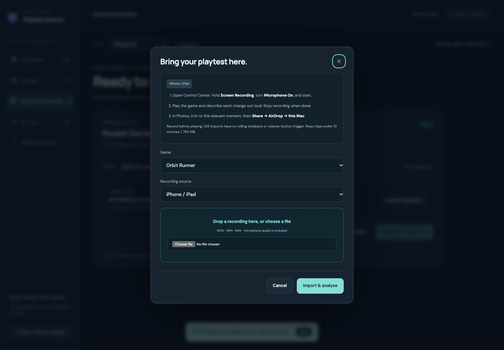

# Playtest on iPhone or iPad

The shipped iOS path uses Apple’s system screen recorder and the Mac desk’s import flow. It works without installing an iOS app, a developer account or TestFlight. The Android APK cannot be installed on an iPhone.

## Capture the game and your voice

1. Open **Control Center**. If Screen Recording is missing, add it to Control Center.
2. Touch and hold **Screen Recording**, switch **Microphone On**, then tap **Start Recording**. Wait for the countdown.
3. Open the game and play. Describe what happened, what you expected and what you want changed. Record before you begin playing so an unexpected bug is already in the recording.
4. Stop through the red recording indicator or Control Center. The recording is saved in **Photos**. [Apple’s recording guide](https://support.apple.com/en-us/102653).
5. In Photos, trim long sessions to the relevant moment, keeping the spoken explanation. Imports allow MOV/MP4/M4V, up to 10 minutes and 750 MB.
6. Choose **Share → AirDrop → your Mac**, and accept the transfer. [Apple’s AirDrop guide](https://support.apple.com/en-us/119857).

## Import, approve and fix

Open Playtest Demon on the Mac. Click **Import recording**, pick the game, select iPhone/iPad and drop the AirDropped recording (usually in Downloads). You can also drop a file onto the desk to open the import dialog.

The upload shows progress, then converts the video for browser playback. The recording enters the same analysis queue as Android clips. ffmpeg preserves audio, whisper transcribes locally and your chosen video analyst drafts requests. Review, approve and send batches to the connected game agent exactly as for Android. [Fix-run setup](FIX-RUNS.md).

An interrupted upload can be retried. The same exact file creates one recording, even if submitted twice. A differently trimmed/exported version has a different hash; use the review’s duplicate-link action when it describes an existing request.

## What differs from Android

- There is no automatic 0–30 second rolling lookback or Volume Up trigger in this shipped iOS route. Start the system recording before testing, then trim afterwards.
- Transfer is manual via AirDrop/import. “Phone connected” in the desk describes the Android receiver, not an iPhone pairing state.
- Microphone must be enabled in Apple’s recorder. Some apps block protected content or audio; watch the imported video and confirm your quote appears before approval.
- This is not a native ReplayKit capture app. A future native app needs signed app/extension provisioning and physical-device validation; Apple’s [ReplayKit framework](https://developer.apple.com/documentation/replaykit) is the appropriate integration for screen broadcasting.

Verification in this release uses synthetic MOV recordings with audio, conversion, transcription and review. A physical iPhone recording/AirDrop session has not been tested on the owner’s device.
